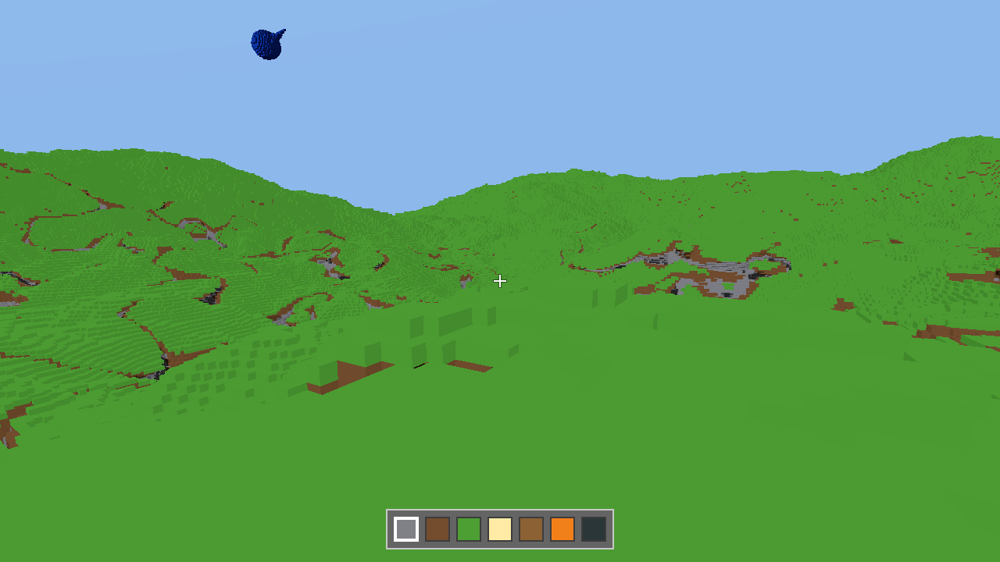
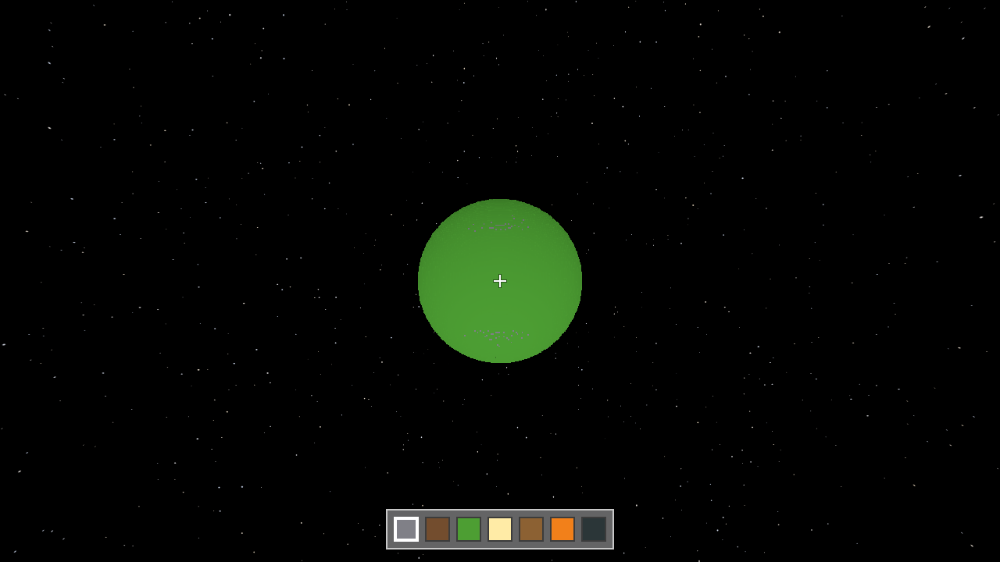

# Voxunami

A blocky spaceflight sandbox, and the voxel engine under it, written in Rust. You can stand on a planet under a moving sun,
see the whole of it from orbit, and (this part is the plan, not yet the game) build a ship and fly off to other worlds.

<p>
  
  
</p>

*Both pictures are the game as it is now, the planet from its surface and from about 260 km up. (The blue shape in the sky is a piece of a "great river", which spans the universe.)*

## What is here today

- **Whole planets.** Cave's planet is 63 km in radius, with hills and caves. You see it from the ground out to orbit in one
  go: a coarse level-of-detail tree covers 116 sizes of cell, enough that a "great river" spanning the universe can be seen from
  light-years away.
- **A solar system that keeps time.** A sun lights a day that lasts 20 minutes and stars turn overhead. Planets and moons
  can orbit each other, each place a pure function of the world's clock (`games/voxunami_cave/examples/packs/solar_system`
  is a star, a planet and a moon, made with a pack and no code).
- **Ships made of blocks** that fall, rest, dock to each other and are carried by the planet they stand on.
- **Multiplayer from the start.** Singleplayer is a server in the same process; a friend joins yours with `--join`.
  Everything a client sees comes from the server's message stream, so any session can be recorded and watched again.
- **The same world on Windows and Linux**, bit for bit: the simulation avoids anything the two systems do differently.
- **Packs of JSON add blocks and planets** with no code, checked with good error messages before a server loads them
  (`docs/pack-format.md`).

## What is not

- **There is no flight yet.** No engines, fuel or steering: you walk and fly like a creative-mode player. The ship parts, a
  reason to leave the ground and a first trip to the moon are what comes next.
- No sound, no menus, no goals, no tutorial. It is a tech demo that wants to become a game.
- Mods are data packs only. Code mods that run safely on a server are planned and not started.
- It is young and changes quickly. A saved world may stop loading between versions.

## Try it

You need [Rust](https://rustup.rs) (stable), a GPU with Vulkan or DirectX 12, and Windows or Linux. A first build takes a
couple of minutes.

```
cargo run --release -p launcher -- cave
```

Click the window to capture the mouse; `W A S D` walk, `F` toggles flying, left and right click break and place blocks.
`--help` lists everything else, including `--host` and `--join` to play with a friend, and `serve cave` for a dedicated server.

## How it is put together

Three layers, and a crate may use only its own layer and those below it (a test checks this):
`engine/*` (the voxel engine, with no idea what any game is), `plugins/*` (content, such as the first blocks), and `games/*`
(Cave, plus two small ones that keep the engine honest: 2048 and Eels). `docs/design-decisions.md` says why it is built this way.

## Status

One person and an AI pair-programmer (Claude) build this, in the open, in short bursts. There is no licence yet, so for now it is
here to read, not to reuse. If you want to see whether a blocky spaceflight game with proper planets turns out well, star it
and look again in a few months.
